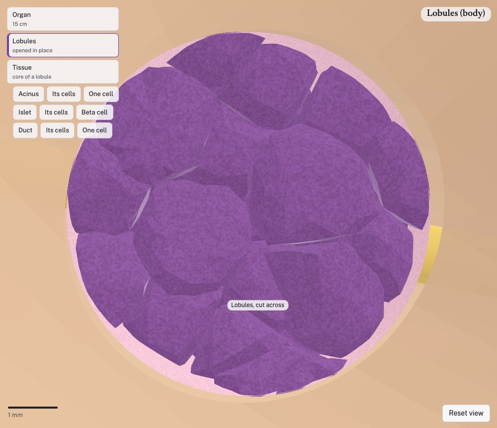
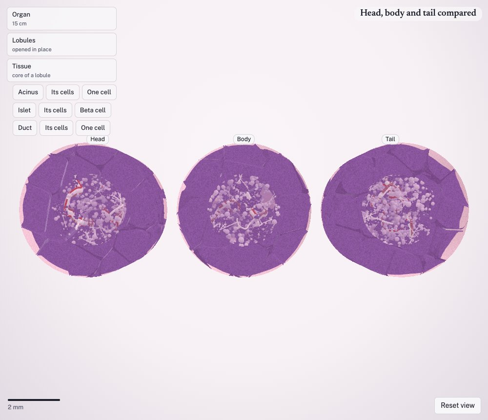
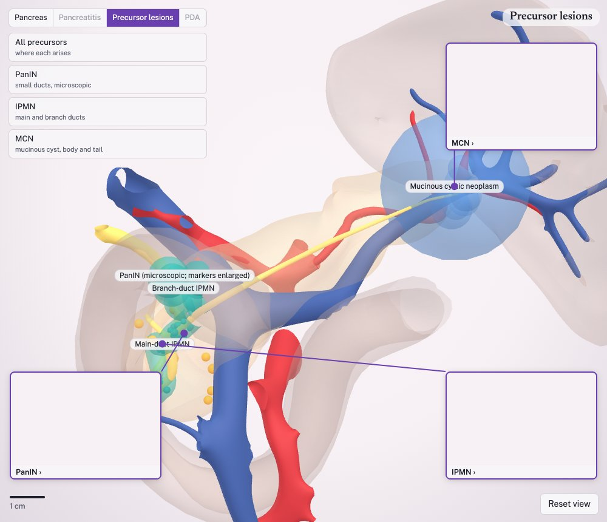
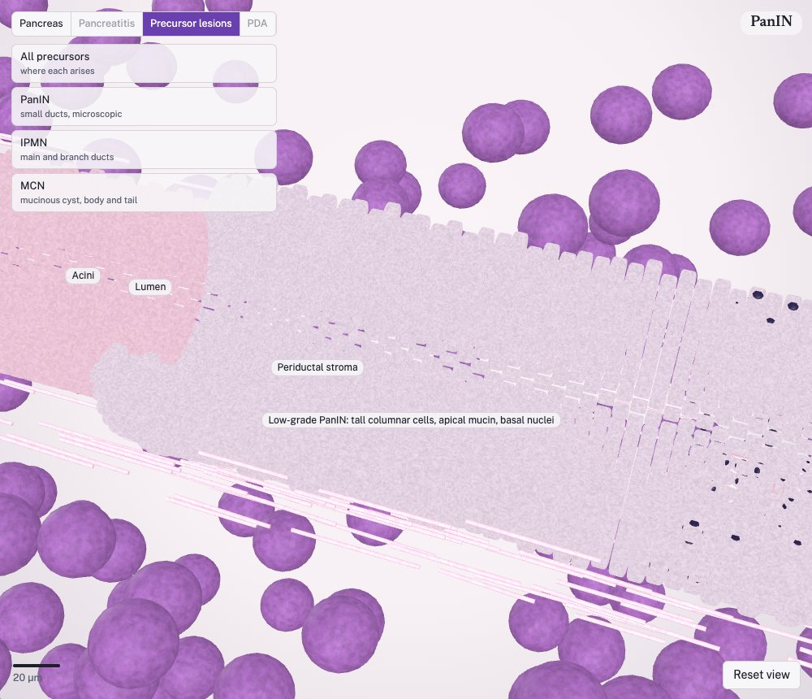
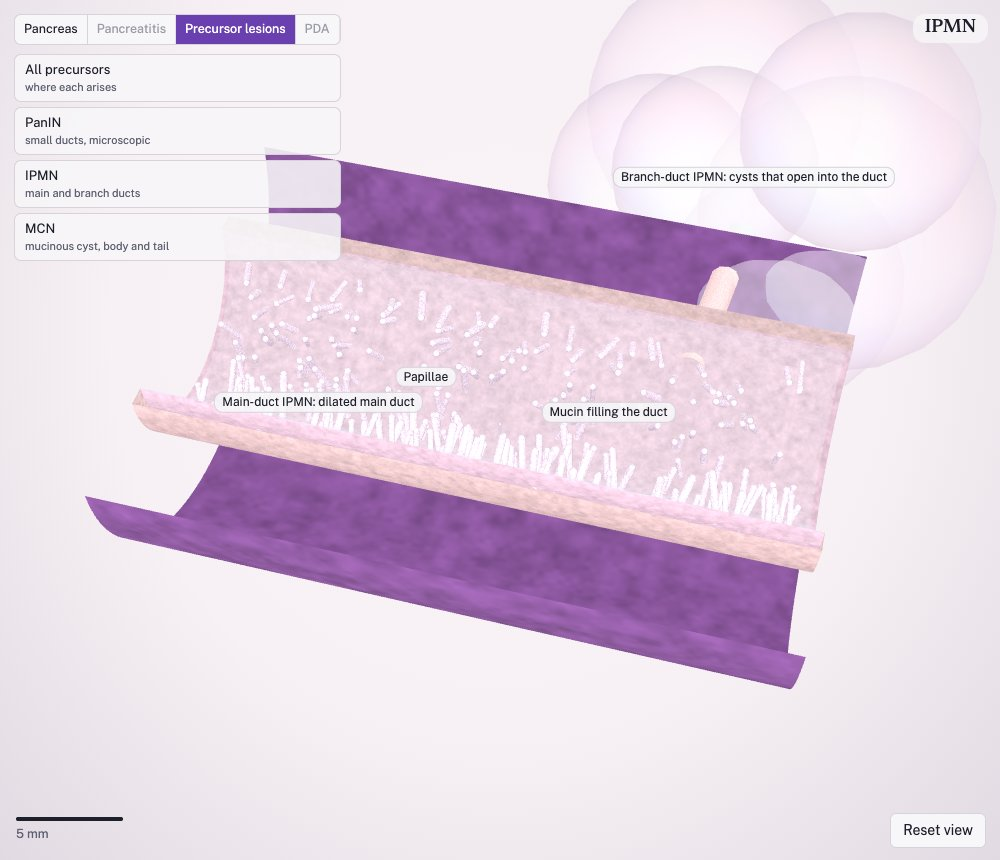
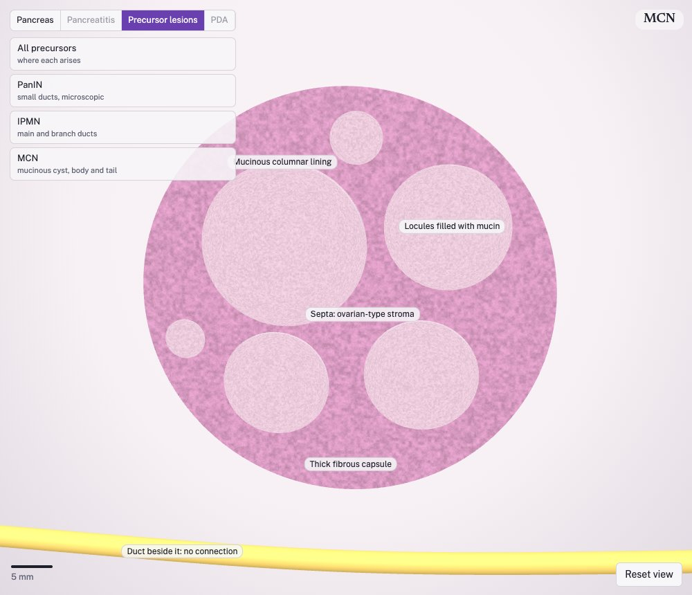

# Human pancreas 3D — from organ to cell

**[Open the interactive viewer →](https://osamashiraz.github.io/pancreas-3d/)** (runs in the browser; Chrome or Edge recommended)

An explorable 3D model of the human pancreas that you can zoom through continuously: from the whole organ (about 15 cm) opened in place layer by layer through its lobules and duct tree to a core of tissue, then a single acinus, islet or duct, its separated cells, and finally one cell with its organelles — all at true scale, in H&E or cell-type colours, with an optional narrated tour.


## The idea

### Why I built this

This project grew out of personal curiosity: I wanted to understand the pancreas better. It is a single organ that holds two very different units: an **exocrine** part that makes digestive enzymes, and an **endocrine** part, the islets, that controls blood sugar. When either one goes wrong, the result can be a debilitating disease: **diabetes** from the endocrine side, and **pancreatitis** and **pancreatic ductal adenocarcinoma** from the exocrine side.

As a bioinformatician, I am always curious about the biology behind the diseases I study in data. This project gathers some of what I have learned while working on pancreatic cancer research, and I built it to see that biology in three dimensions and to share it with others.

### Seeing the scales together

The pancreas is usually taught in pieces: a gross-anatomy drawing in one lecture, an H&E slide in another, a cartoon of an acinar cell in a third. It is hard to hold in one's head how those scales connect — where an islet sits relative to the main duct, how many acini drain into one intercalated duct, what a beta cell looks like next to its capillary.

This project puts those scales into one continuous space so a learner can move between them. It is built as a **learning tool** for students, trainees and researchers, and as a **scaffold** for showing where disease begins (see [Next steps](#next-steps)).

It is also built to be honest about what it knows. Every structure carries one of three labels, and the viewer shows it:

- **source** — drawn by the Human Reference Atlas from the Visible Human Project (organ shape, main ducts, large vessels);
- **traced** — followed from a published image;
- **simulated** — placed by a written rule from published measurements (small vessels, lymph nodes, lobules, acini, islets, cells).

Every number either names its source or is marked *not yet sourced* in the code, and the tests fail if one is missing.

## What you can see

### The organ, opened layer by layer

The reference pancreas (head, neck, body, tail, uncinate process) with the main and accessory pancreatic ducts, bile duct and ampulla, and the coeliac, splenic, hepatic and superior mesenteric vessels. Sixty tissue sites (20 each in head, body and tail) lie hidden in the gland: zoom in on any part of the organ and one of the sites nearest the pointer is picked at random and brought to the middle of the view.

Zooming into a site opens the gland **in place, layer by layer**, the way [MouseBio_3D](https://github.com/Qasim-Hussain-Code/MouseBio_3D) opens the mouse: a line goes into the gland at the site, and as you zoom the organ's surface opens round it. Inside, the **lobules** stand cut across, with pale septa of connective tissue between them. Round the line, the lobules near the site open in turn to show what fills them: the **duct tree** (large interlobular duct with its artery and vein, interlobular, intralobular and terminal ducts ending in grape-like clusters of acini) and the **islets**, twice as dense in the tail as in the head. At the bottom of the opening lies a **core of tissue**, cut flat through its islet. Each outer layer stays as a ring round the next, and zooming out closes them again.

| Organ | The surface opens | Lobules and their ducts | Tissue core |
|---|---|---|---|
|  |  |  |  |

**Compare head, body and tail** puts the three regions' lobule columns side by side, each opened to its duct tree and islets:



### Inside the tissue: how the pancreas works

The pancreas is two organs in one, and the model shows both:

- **Exocrine (digestion)** — about 98% of the tissue. Wedge-shaped *acinar cells* arranged like orange segments around a tiny lumen make digestive enzymes: rough ER around the basal nucleus synthesises them, the Golgi packages them, and *zymogen granules* wait at the cell apex for release. Each acinus empties into its own *intercalated duct*, lined at its start by *centroacinar cells*; ducts merge into intralobular, interlobular and finally the main pancreatic duct, which joins the bile duct at the ampulla in the duodenum. *Duct cells* add bicarbonate-rich fluid (through CFTR and SLC26A6) that carries the enzymes and neutralises stomach acid.
- **Endocrine (blood sugar)** — about 1–2%. *Islets of Langerhans* (about 110 µm, a few hundred cells each) contain beta cells (insulin), alpha cells (glucagon), delta cells (somatostatin) and PP cells, intermixed along a dense capillary bed as in human islets. A *beta cell* is shown with its insulin granules (dense crystalline cores in pale halos), primary cilium and neighbouring capillary.

| Acinus | Islet (cell-type colours) | Acinar cell | Beta cell |
|---|---|---|---|
|  |  |  |  |

### Viewer features

- Continuous zoom from organ to organelle, with a scale bar; **Esc** steps back a level.
- **Layers opened in place**: organ surface → lobules → duct tree → tissue core, each a ring round the next; the view turns to look down the opening until you turn it yourself.
- Three branches to follow: **acinus → acinar cells → one acinar cell**, **islet → islet cells → beta cell**, **duct → duct cells → one duct cell**.
- **Stain**: H&E (purple nuclei, pink cytoplasm, red granules, pale islets) or **Cell types** (immunofluorescence-like colours).
- **Cut open** a structure, **slice apart** (organ into transverse slices, tissue into serial sections), **split screen** to compare two views, **compare head, body and tail**.
- **Beta, alpha and delta cells**, each with its own granules (beta ~350 nm with clear halos, alpha ~200 nm and dense, delta ~250 nm); the delta cell reaches its neighbours with long processes.
- **Secretion in motion** (Motion on): zymogen granules travel to the apex and release enzymes down the duct; duct cells secrete bicarbonate through CFTR and SLC26A6; a beta cell takes up glucose and releases insulin into its capillary; alpha cells release glucagon; delta cells release somatostatin beside their neighbours. The journey narrates each.
- **Marker genes** for the cell in view or clicked, from the HRA ASCT+B table and the Human Protein Atlas, each linking to its HPA page.
- **Play the journey**: a 13-step narrated tour in Google's UK English female voice (Chrome; other browsers use a standard UK voice).
- Click any cell or structure to name it, isolate it or fade it.
- **Links to a view**: the address follows what you are looking at, e.g. [`#site=9&view=islet&stain=if`](https://osamashiraz.github.io/pancreas-3d/#site=9&view=islet&stain=if), so a view can be shared or used in teaching.

### Where pancreatic cancer begins: precursor lesions

The switch at the top left chooses what to show: **Pancreas** (organ to cell), **Precursor lesions**, and later **Pancreatitis** and **PDA**. In **Pancreas** the ladder goes from the organ to the tissue, where the two compartments sit side by side, then to the **exocrine** structures (acinus, acinar cell, centroacinar cells, duct) and the **endocrine** islets (islet; beta, alpha and delta cells).

**Precursor lesions** first shows the whole organ with each precursor marked where it arises. Following Figure 1 of Hingorani's *Location, location, location* (Gastroenterology 2007), each is linked by a line to an inset of its architecture:



| Precursor | Size | Where in the gland | Where in the duct tree |
|---|---|---|---|
| PanIN | microscopic, usually < 0.5 cm | head and uncinate process | periphery: terminal ductules |
| Mucinous cystic neoplasm | median 3.5–5 cm | body and tail (> 90%) | periphery; no duct connection |
| Main-duct IPMN | main duct > 5 mm (≥ 10 mm high-risk) | head | centre: main duct |
| Branch-duct IPMN | grape-like cysts > 10 mm | head, neck, uncinate | major side branches |

Clicking a lesion or its inset, or zooming into it, opens its own view, down to its cells:

| PanIN | IPMN | MCN |
|---|---|---|
|  |  |  |
| A small duct opened lengthwise: normal cuboidal lining → low-grade PanIN (tall columnar cells, apical mucin, basal nuclei) → high-grade (papillae, atypical nuclei, loss of polarity) | A dilated main duct with finger-like papillae and mucin; beside it grape-like branch-duct cysts that open into the duct; one papilla drawn to its cells | A cyst cut in half: fibrous capsule, mucin-filled locules, septa of ovarian-type stroma; no connection with the duct; one stretch of wall drawn to its cells |

Each comes with a card on its appearance, grading, genes, who it affects and survival, in our own words, citing Hingorani 2007, Rodriguez et al. 2007, *The Pancreas: An Integrated Textbook* (Beger et al., 4th ed., 2023) and *Robbins and Cotran Pathologic Basis of Disease* (9th ed.). Placement on the organ is simulated by rule; drawn sizes follow the stated sizes.

## Datasets and sources

| What | Source | Use in the model |
|---|---|---|
| Organ, ducts, large vessels, duodenum, spleen | **HRA 3D Reference Object Library** v2.0 (HuBMAP), derived from the **Visible Human Project** (U.S. National Library of Medicine), male and female; CC BY 4.0 | 29 named meshes per sex copied byte-for-byte; organ volume by voxelisation |
| Cell types and ontology terms | **HRA ASCT+B table** for the pancreas and the HRA crosswalk | Cell-type names, UBERON/FMA/CL identifiers, islet composition |
| Islet number, size, clustering | Hahn et al., *Commun Biol* 2021 | ~1.7–1.8 million islets per organ, peripheral clusters |
| Regional islet density | Wang et al., *PLoS One* 2013 | Tail about twice head and body |
| Islet architecture | Cabrera et al., *PNAS* 2006; Brissova et al., *J Histochem Cytochem* 2005 | Intermixed alpha/beta cells, 71% heterotypic contacts |
| Beta-cell volume | Reers et al., *Eur J Endocrinol* 2009 | Beta-cell volume fraction (2.3%) |
| Tissue architecture | Kiemen et al. (CODA), *Nat Methods* 2022 | Grape-like acinar clusters, collagen along ducts |
| Ducts and centroacinar cells | Endo et al. 2002 (rat); Beer et al. 2016 | One intercalated duct per acinus, no anastomoses |
| Cell biology | Palade 1975; Messenger et al. 2014; Berclaz et al. 2016; Steward & Ishiguro 2009; Hegyi & Rakonczay 2015; diIorio et al. 2014 | Secretory pathway, zymogen and insulin granules, duct secretion, cilia |
| Marker genes | **HRA ASCT+B** pancreas v1.3 (doi:10.48539/HBM336.TBNP.923); **Human Protein Atlas** v26.0 (CC BY-SA 4.0) | Marker panel per cell type (`repo/data/human-pancreas-markers.json`) |
| Precursor lesions | Hingorani, *Gastroenterology* 2007 (doi:10.1053/j.gastro.2007.05.059); Rodriguez et al., *Gastroenterology* 2007; Beger et al., *The Pancreas*, 4th ed., Wiley 2023 (ch. 81, 84, 86, 125, 126); Kumar, Abbas, Aster, *Robbins and Cotran*, 9th ed., 2015 (ch. 19) | Where PanIN, MCN and IPMN arise; sizes, grades, genes; architecture of each view |
| Normal anatomy (checks) | Gorelick & Williams, eds., *The Pancreas: Biology and Physiology*, APA 2021 (CC BY-NC-ND; ch. 1 Longnecker) | Islet size and number, endocrine fraction, zymogen granule size |
| Secretion and islet cells | Lee et al., *Physiol Rev* 2012; Rorsman & Ashcroft, *Physiol Rev* 2018; Brereton et al., *J Histochem Cytochem* 2015; Arrojo e Drigo et al., *Nat Commun* 2019 | Bicarbonate and insulin secretion; granule sizes; delta-cell processes |
| Teaching text | StatPearls (NCBI Bookshelf, CC BY 4.0); Columbia and Basel histology notes; Human Protein Atlas | Narration, paraphrased in our own words with credit |

Full references with DOIs: [`docs/SOURCES.md`](docs/SOURCES.md). Values still awaiting a source (for example acinar cell height, duct radii, lobule size, organelle counts) are listed in [`docs/SPEC.md`](docs/SPEC.md) §9.

## How it is built

- **Organ**: meshes extracted unchanged from the HRA united body models; small arteries (gastroduodenal, pancreaticoduodenal arcades, dorsal/great/caudal pancreatic) routed by shortest path around drawn structures; lymph nodes placed at the Japan Pancreas Society stations (that citation, and Gray's Anatomy for vessel anatomy, are still to be checked against the books).
- **Tissue**: deterministic builders (Python, and a TypeScript generator that also runs in the browser) grow a duct tree, bud acini on their own intercalated ducts, route capillaries so every acinus is within reach, add stroma and one islet, then let cells grow until they meet a neighbour. Tests check the rules: no overlapping acini, one duct per acinus, packing above 45%, islet composition and size.
- **Viewer**: a single self-contained HTML page (three.js) with the models embedded, so it can be hosted anywhere static. The layered openings follow MouseBio_3D's zoom-unfold: each opening grows with the zoom to nearly half the height of the view, outer layers stay as rings, and vessels and ducts of the organ are left uncut.

## Repository layout

| Path | What |
|---|---|
| `dist/pancreas-organ-to-cell.html` | The built viewer (published to GitHub Pages) |
| `viewer/` | Viewer sources (`template.html`, `src/app.js`, `src/generator.js`), build script, smoke test, earlier versions in `legacy/` |
| `repo/` | Module for [MouseBio_3D](https://github.com/Qasim-Hussain-Code/MouseBio_3D): inventory, generators, loader, tests, Python builders, model data |
| `docs/` | Specification, backlog, change history, sources, README images |
| `scripts/install_into_mousebio.sh` | Copies `repo/` into a MouseBio_3D checkout and runs its checks |
| `CLAUDE.md` | Working rules for continuing the project with Claude Code |

### Run it locally

Open `dist/pancreas-organ-to-cell.html` in a browser (it needs internet for three.js and fonts). To rebuild and test:

```bash
git clone https://github.com/Qasim-Hussain-Code/MouseBio_3D && cd MouseBio_3D && npm ci
bash ../pancreas-3d/scripts/install_into_mousebio.sh .        # copy the module in, type-check, run its tests
python3 ../pancreas-3d/viewer/build_viewer.py . ../pancreas-3d/dist/pancreas-organ-to-cell.html
```

Python builders need `numpy` and `scipy`; the smoke test needs `playwright`. Pushing a new `dist/` to `main` republishes the GitHub Pages site.

## Next steps

1. **Nearby organs** — extend from the pancreas to its neighbours using the same HRA body models: the full duodenum and stomach, spleen, liver and biliary tree with the gallbladder, left kidney and adrenal, and the coeliac and mesenteric vessels and nerves that tie them together. This is where most surgical and imaging anatomy of the pancreas lives.
2. **Tumours** — show where pancreatic cancers arise by region (head, body, tail) and by cell of origin (ductal adenocarcinoma, neuroendocrine tumours, acinar cell carcinoma), and how they relate to the bile duct, vessels and lymph node stations that matter for staging and resectability.
3. **Precursor lesions** — PanIN (pancreatic intraepithelial neoplasia) in small ducts, IPMN (intraductal papillary mucinous neoplasm) in the main or branch ducts, and mucinous cystic neoplasms, placed in the duct tree at the scale where they occur.
4. **Pancreatitis and fibrosis** — acute pancreatitis (acinar injury, oedema, inflammation) and chronic pancreatitis (acinar loss, activated stellate cells, fibrosis, duct changes), as alternative states of the same tissue.
5. Also planned: diabetes states (beta-cell loss) and overlay of single-cell and spatial data. See [`docs/BACKLOG.md`](docs/BACKLOG.md).

Disease content will follow the same rule as the rest of the model: each lesion's location, size and frequency will cite its source, and anything placed by rule will be labelled simulated.

## Limitations

This is a teaching and communication model, not a patient-specific or diagnostic one. The organ comes from one male and one female reference body; everything below the organ scale is simulated from published descriptions, and some sizes are typical values not yet sourced (marked in the code and listed in the spec). Known issues are in [`docs/BACKLOG.md`](docs/BACKLOG.md).

## Licence and credit

- Code: MIT (see [`LICENSE`](LICENSE)), as MouseBio_3D.
- Model data derived from the HRA 3D Reference Object Library: CC BY 4.0 — see [`repo/public/atlas-human/NOTICE.md`](repo/public/atlas-human/NOTICE.md). Cite: Börner K, et al. *Nat Methods* 2025;22:845–860. doi:10.1038/s41592-024-02563-5.
- Visible Human Project, U.S. National Library of Medicine.
- Narration and page text are our own wording, paraphrased from open sources (StatPearls CC BY 4.0, university histology notes, Human Protein Atlas) with credit.
