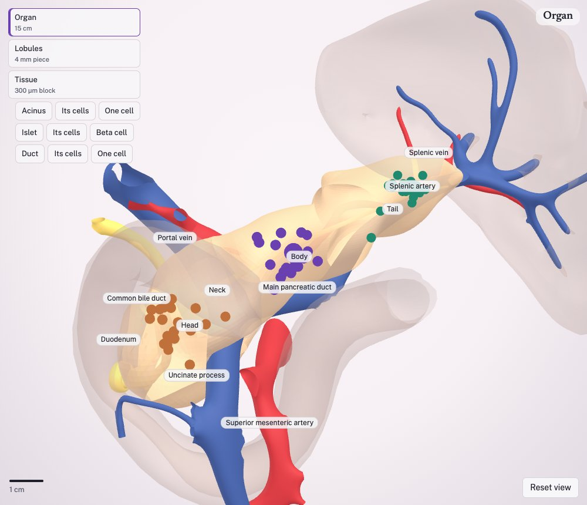
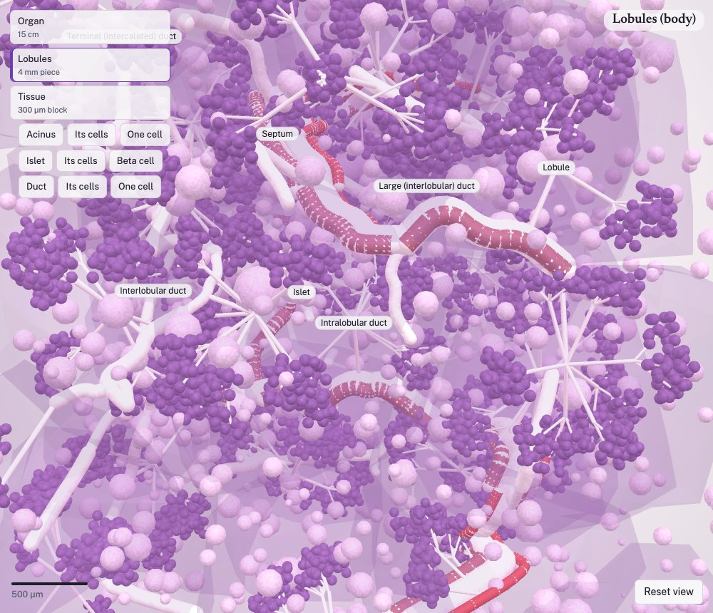
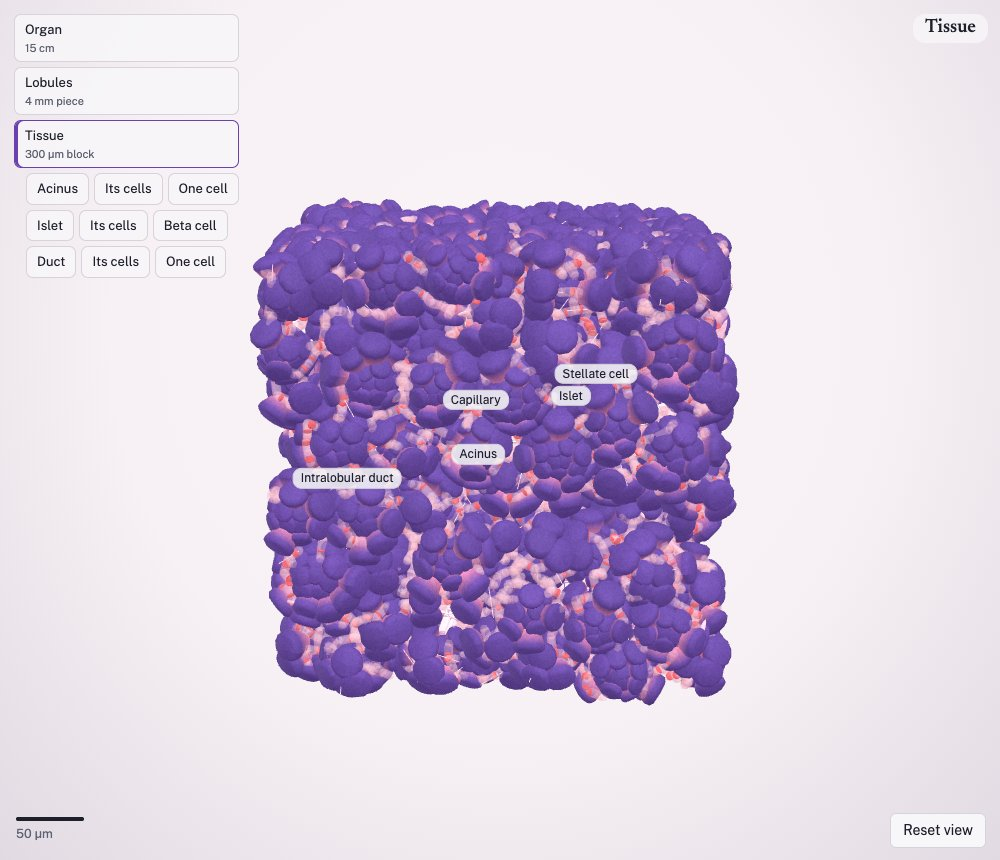
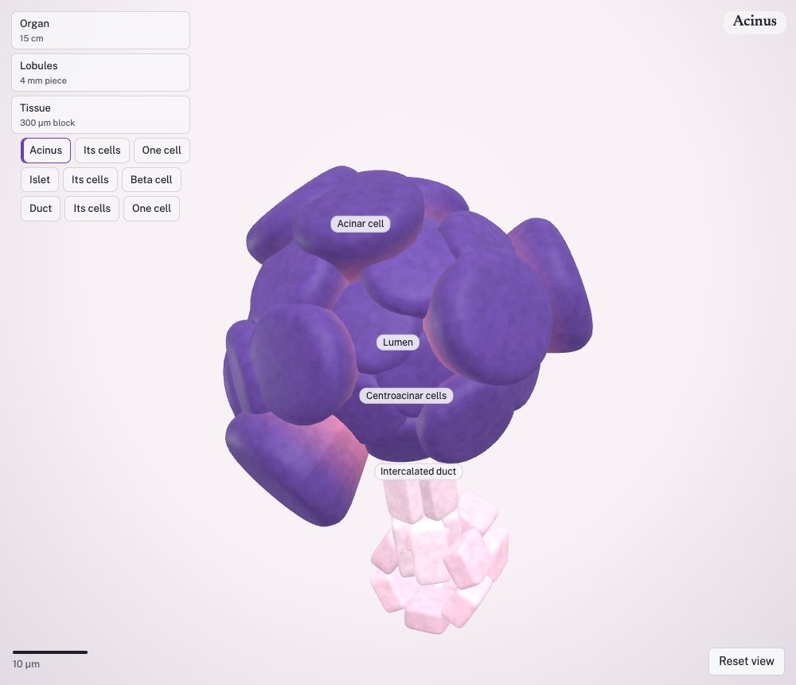
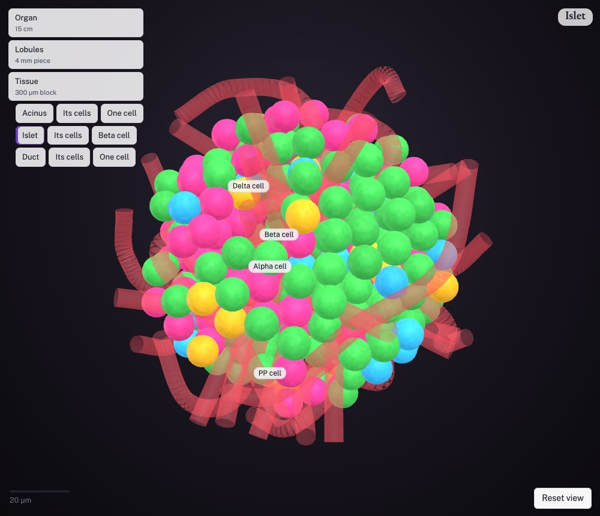
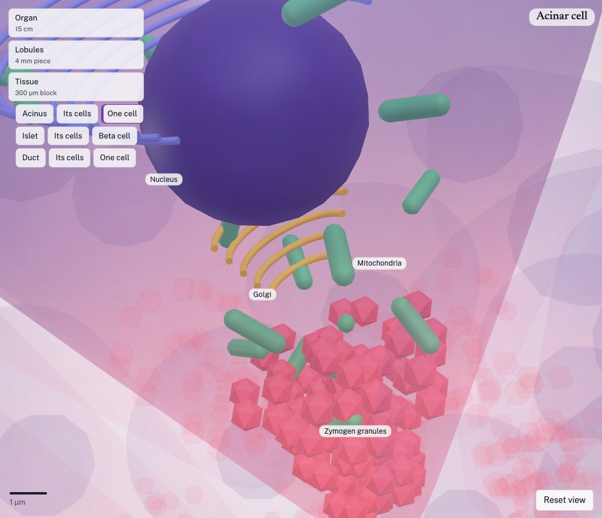
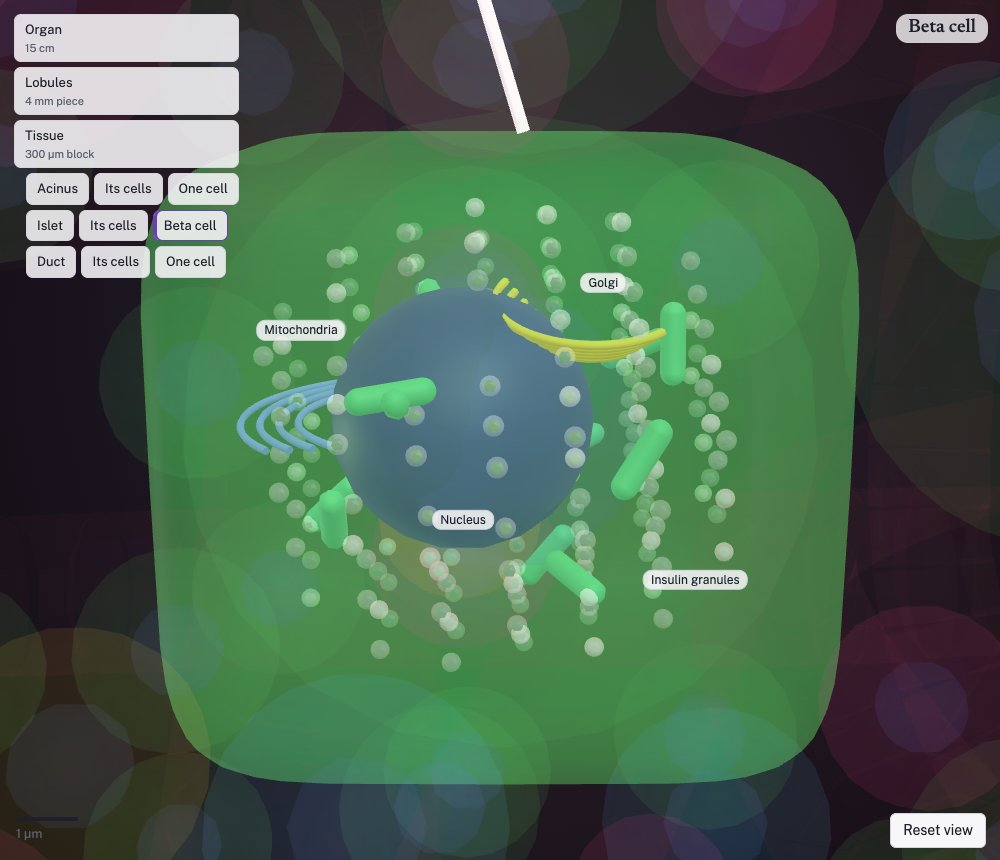

# Human pancreas 3D — from organ to cell

**[Open the interactive viewer →](https://osamashiraz.github.io/pancreas-3d/)** (runs in the browser; Chrome or Edge recommended)

An explorable 3D model of the human pancreas that you can zoom through continuously: from the whole organ (about 15 cm) to a 4 mm piece of lobules, a 300 µm block of tissue, a single acinus, islet or duct, its separated cells, and finally one cell with its organelles — all at true scale, in H&E or cell-type colours, with an optional narrated tour.



## The idea

The pancreas is usually taught in pieces: a gross-anatomy drawing in one lecture, an H&E slide in another, a cartoon of an acinar cell in a third. It is hard to hold in one's head how those scales connect — where an islet sits relative to the main duct, how many acini drain into one intercalated duct, what a beta cell looks like next to its capillary.

This project puts those scales into one continuous space so a learner can move between them. It is built as a **learning tool** for students, trainees and researchers, and as a **scaffold** for showing where disease begins (see [Next steps](#next-steps)).

It is also built to be honest about what it knows. Every structure carries one of three labels, and the viewer shows it:

- **source** — drawn by the Human Reference Atlas from the Visible Human Project (organ shape, main ducts, large vessels);
- **traced** — followed from a published image;
- **simulated** — placed by a written rule from published measurements (small vessels, lymph nodes, lobules, acini, islets, cells).

Every number either names its source or is marked *not yet sourced* in the code, and the tests fail if one is missing.

## What you can see

### The organ and its lobules

The reference pancreas (head, neck, body, tail, uncinate process) with the main and accessory pancreatic ducts, bile duct and ampulla, and the coeliac, splenic, hepatic and superior mesenteric vessels. Sixty tissue sites (dots in head, body and tail) are the places you can zoom into. Zooming in reaches a 4 mm piece: lobules separated by connective-tissue septa, a tree of ducts running from large interlobular ducts down to terminal ducts, grape-like clusters of acini, and islets scattered among them (twice as dense in the tail as in the head).

| Organ | Lobules (4 mm) | Tissue block (300 µm) |
|---|---|---|
|  |  |  |

### Inside the tissue: how the pancreas works

The pancreas is two organs in one, and the model shows both:

- **Exocrine (digestion)** — about 98% of the tissue. Wedge-shaped *acinar cells* arranged like orange segments around a tiny lumen make digestive enzymes: rough ER around the basal nucleus synthesises them, the Golgi packages them, and *zymogen granules* wait at the cell apex for release. Each acinus empties into its own *intercalated duct*, lined at its start by *centroacinar cells*; ducts merge into intralobular, interlobular and finally the main pancreatic duct, which joins the bile duct at the ampulla in the duodenum. *Duct cells* add bicarbonate-rich fluid (through CFTR and SLC26A6) that carries the enzymes and neutralises stomach acid.
- **Endocrine (blood sugar)** — about 1–2%. *Islets of Langerhans* (about 110 µm, a few hundred cells each) contain beta cells (insulin), alpha cells (glucagon), delta cells (somatostatin) and PP cells, intermixed along a dense capillary bed as in human islets. A *beta cell* is shown with its insulin granules (dense crystalline cores in pale halos), primary cilium and neighbouring capillary.

| Acinus | Islet (cell-type colours) | Acinar cell | Beta cell |
|---|---|---|---|
|  |  |  |  |

### Viewer features

- Continuous zoom from organ to organelle, with a scale bar; **Esc** steps back a level.
- Three branches to follow: **acinus → acinar cells → one acinar cell**, **islet → islet cells → beta cell**, **duct → duct cells → one duct cell**.
- **Stain**: H&E (purple nuclei, pink cytoplasm, red granules, pale islets) or **Cell types** (immunofluorescence-like colours).
- **Cut open**, **slice apart** (organ into transverse slices, block into serial sections), **split screen** to compare two views, **compare head, body and tail**.
- **Play the journey**: a 13-step narrated tour (browser speech; best in Chrome).
- Click any cell or structure to name it, isolate it or fade it.

## Datasets and sources

| What | Source | Use in the model |
|---|---|---|
| Organ, ducts, large vessels, duodenum, spleen | **HRA 3D Reference Object Library** v2.0 (HuBMAP), derived from the **Visible Human Project** (U.S. National Library of Medicine), male and female; CC BY 4.0 | 29 named meshes per sex copied byte-for-byte; organ volume by voxelisation |
| Cell types and ontology terms | **HRA ASCT+B table** for the pancreas and the HRA crosswalk | Cell-type names, UBERON/FMA/CL identifiers, islet composition |
| Islet number, size, clustering | Hahn et al., *Commun Biol* 2021 | ~1.7–1.8 million islets per organ, peripheral clusters |
| Regional islet density | Wang et al., *PLoS One* 2013 | Tail about twice head and body |
| Islet architecture | Cabrera et al., *PNAS* 2006; Brissova et al., *J Histochem Cytochem* 2005 | Intermixed alpha/beta cells, 71% heterotypic contacts |
| Beta-cell volume | Reers et al., *Eur J Endocrinol* 2009 | Beta-cell volume fraction (2.3%) |
| Tissue architecture | Kiemen et al. (CODA), *Nat Methods* 2022 | Grape-like acinar clusters, collagen along ducts |
| Ducts and centroacinar cells | Endo et al. 2002 (rat); Beer et al. 2016 | One intercalated duct per acinus, no anastomoses |
| Cell biology | Palade 1975; Messenger et al. 2014; Berclaz et al. 2016; Steward & Ishiguro 2009; Hegyi & Rakonczay 2015; diIorio et al. 2014 | Secretory pathway, zymogen and insulin granules, duct secretion, cilia |
| Teaching text | StatPearls (NCBI Bookshelf, CC BY 4.0); Columbia and Basel histology notes; Human Protein Atlas | Narration, paraphrased in our own words with credit |

Full references with DOIs: [`docs/SOURCES.md`](docs/SOURCES.md). Values still awaiting a source (for example acinar cell height, duct radii, lobule size, organelle counts) are listed in [`docs/SPEC.md`](docs/SPEC.md) §9.

## How it is built

- **Organ**: meshes extracted unchanged from the HRA united body models; small arteries (gastroduodenal, pancreaticoduodenal arcades, dorsal/great/caudal pancreatic) routed by shortest path around drawn structures; lymph nodes placed at the Japan Pancreas Society stations (that citation, and Gray's Anatomy for vessel anatomy, are still to be checked against the books).
- **Tissue**: deterministic builders (Python, and a TypeScript generator that also runs in the browser) grow a duct tree, bud acini on their own intercalated ducts, route capillaries so every acinus is within reach, add stroma and one islet, then let cells grow until they meet a neighbour. Tests check the rules: no overlapping acini, one duct per acinus, packing above 45%, islet composition and size.
- **Viewer**: a single self-contained HTML page (three.js) with the models embedded, so it can be hosted anywhere static.

## Repository layout

| Path | What |
|---|---|
| `dist/pancreas-organ-to-cell.html` | The built viewer (published to GitHub Pages) |
| `viewer/` | Viewer sources (`template.html`, `src/app.js`, `src/generator.js`), build script, smoke test, earlier versions in `legacy/` |
| `repo/` | Module for [MouseBio_3D](https://github.com/Qasim-Hussain-Code/MouseBio_3D): inventory, generators, loader, tests, Python builders, model data |
| `docs/` | Specification, backlog, change history, sources, README images |
| `scripts/install_into_mousebio.sh` | Copies `repo/` into a MouseBio_3D checkout and runs its checks |
| `CLAUDE.md` | Working rules for continuing the project with Claude Code |

### Run it locally

Open `dist/pancreas-organ-to-cell.html` in a browser (it needs internet for three.js and fonts). To rebuild and test:

```bash
git clone https://github.com/Qasim-Hussain-Code/MouseBio_3D && cd MouseBio_3D && npm ci
bash ../pancreas-3d/scripts/install_into_mousebio.sh .        # copy the module in, type-check, run its tests
python3 ../pancreas-3d/viewer/build_viewer.py . ../pancreas-3d/dist/pancreas-organ-to-cell.html
```

Python builders need `numpy` and `scipy`; the smoke test needs `playwright`. Pushing a new `dist/` to `main` republishes the GitHub Pages site.

## Next steps

1. **Nearby organs** — extend from the pancreas to its neighbours using the same HRA body models: the full duodenum and stomach, spleen, liver and biliary tree with the gallbladder, left kidney and adrenal, and the coeliac and mesenteric vessels and nerves that tie them together. This is where most surgical and imaging anatomy of the pancreas lives.
2. **Tumours** — show where pancreatic cancers arise by region (head, body, tail) and by cell of origin (ductal adenocarcinoma, neuroendocrine tumours, acinar cell carcinoma), and how they relate to the bile duct, vessels and lymph node stations that matter for staging and resectability.
3. **Precursor lesions** — PanIN (pancreatic intraepithelial neoplasia) in small ducts, IPMN (intraductal papillary mucinous neoplasm) in the main or branch ducts, and mucinous cystic neoplasms, placed in the duct tree at the scale where they occur.
4. **Pancreatitis and fibrosis** — acute pancreatitis (acinar injury, oedema, inflammation) and chronic pancreatitis (acinar loss, activated stellate cells, fibrosis, duct changes), as alternative states of the same tissue.
5. Also planned: diabetes states (beta-cell loss), marker genes on click from the ASCT+B table, overlay of single-cell and spatial data, and secretion in motion. See [`docs/BACKLOG.md`](docs/BACKLOG.md).

Disease content will follow the same rule as the rest of the model: each lesion's location, size and frequency will cite its source, and anything placed by rule will be labelled simulated.

## Limitations

This is a teaching and communication model, not a patient-specific or diagnostic one. The organ comes from one male and one female reference body; everything below the organ scale is simulated from published descriptions, and some sizes are typical values not yet sourced (marked in the code and listed in the spec). Known issues are in [`docs/BACKLOG.md`](docs/BACKLOG.md).

## Licence and credit

- Code: MIT (see [`LICENSE`](LICENSE)), as MouseBio_3D.
- Model data derived from the HRA 3D Reference Object Library: CC BY 4.0 — see [`repo/public/atlas-human/NOTICE.md`](repo/public/atlas-human/NOTICE.md). Cite: Börner K, et al. *Nat Methods* 2025;22:845–860. doi:10.1038/s41592-024-02563-5.
- Visible Human Project, U.S. National Library of Medicine.
- Narration and page text are our own wording, paraphrased from open sources (StatPearls CC BY 4.0, university histology notes, Human Protein Atlas) with credit.
